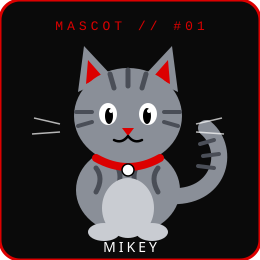
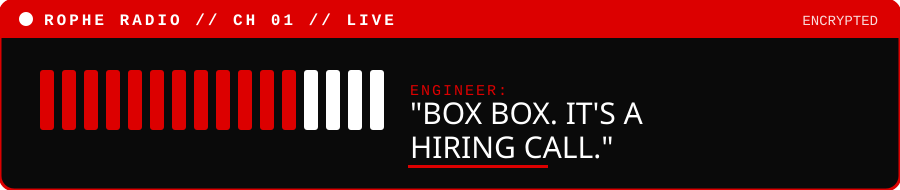

<div align="center">



<br/>

<a href="https://rophe.vercel.app/"></a>


</div>


## 🏁 &nbsp;THE BRIEF

> **Welcome to my digital space.** A portfolio where technology, creativity, experimentation, and a little chaos come together.

I'm **Rophe Angel**, a Computer Science Engineering undergraduate exploring software development, AI, web technologies, and ideas that turn into projects.

This portfolio is more than a collection of projects. It's an **interactive experience** built to reflect my personality, interests, and approach to technology.

Inspired by **Formula 1 aesthetics, anime, and interactive web experiences**, it mixes a bold visual identity with motion, playful interactions, and personal storytelling.


## ⚡ &nbsp;CAR SPECS &nbsp;·&nbsp; FEATURES

<table>
<tr>
<td width="50%" valign="top">

### 🏎️ &nbsp;Ferrari-inspired aesthetic
A bold **red, black and white** visual identity, bold uppercase type, no beige energy allowed.

</td>
<td width="50%" valign="top">

### 🎬 &nbsp;Cinematic intro
An **anime-inspired opening** experience before you even hit the homepage.

</td>
</tr>
<tr>
<td valign="top">

### ✨ &nbsp;Interactive animations
Motion effects and playful UI interactions all across the site.

</td>
<td valign="top">

### 🐈 &nbsp;Mikey the mascot
An interactive **grey tabby cat** who adds personality (and judgement) to the experience.

</td>
</tr>
<tr>
<td valign="top">

### 💻 &nbsp;Project showcase
A space for personal projects, experiments, and case studies.

</td>
<td valign="top">

### 🧠 &nbsp;About & Experience
Background, education, skills, and the entrepreneurial journey.

</td>
</tr>
<tr>
<td valign="top">

### 📡 &nbsp;Rophe Radio
A contact section inspired by **Formula 1 team radio**. Yes, you can "box box" me.

</td>
<td valign="top">

### 🎵 &nbsp;Audio experience
Background music integrated into the portfolio.

</td>
</tr>
<tr>
<td colspan="2" align="center">

### 📱 &nbsp;Responsive design goals
Built to adapt across **desktop, tablet, and mobile** screens.

</td>
</tr>
</table>


## 🐈 &nbsp;MEET THE MASCOT

<table>
<tr>
<td width="280" align="center">



</td>
<td valign="middle">

**Mikey** lives on the portfolio and reacts to you poking around.

```
NAME      Mikey
SPECIES   Grey tabby
ROLE      Chief Vibes Officer
SKILLS    Judging your scroll speed
WEAKNESS  Bugs (the real ones)
```

</td>
</tr>
</table>


## 🛠️ &nbsp;POWER UNIT &nbsp;·&nbsp; TECH STACK

| SYSTEM | TECH | JOB |
| :--- | :--- | :--- |
| 🔴 **Engine** |   | UI development |
| ⚫ **Aero** |  | Styling & responsive layouts |
| 🔴 **Bodywork** |   | Structure, styling, animations |
| ⚫ **Pit Crew** |   | Version control |
| 🔴 **Race Day** |  | Deployment |


## 🚀 &nbsp;FEATURED PROJECTS

The portfolio showcases a mix of **software projects, AI experiments, research concepts, and hackathon work**. Each one is a different attempt to explore an idea, solve a problem, or learn something new.

<div align="center">

**[ ▶ &nbsp;SEE THE PROJECTS ON THE LIVE SITE&nbsp; ◀ ](https://rophe.vercel.app/)**

</div>


## 🎯 &nbsp;WHY I BUILT IT

I wanted a portfolio that felt like **me**, not another standard developer template.

From experimenting with AI-assisted development to refining interactions and debugging unexpected behaviour, this project has been an ongoing loop of **building, testing, learning, and improving.**

> *Because sometimes, the best way to learn something is to build something a little unreasonable.*


## 💻 &nbsp;RUN IT LOCALLY

```bash
# 1. clone the repo
git clone https://github.com/ropheangel1312-design/Rophe-Angel---Portfolio.git

# 2. enter the garage
cd Rophe-Angel---Portfolio

# 3. install dependencies
npm install

# 4. lights out
npm run dev
```

Open the local URL shown in your terminal.

> ⚠️ **Heads up:** some integrations or browser-dependent features may need extra configuration to work locally.


## 📡 &nbsp;RADIO CHECK

<div align="center">



<br/><br/>

<a href="https://www.linkedin.com/in/rophe-angel-b8a051370/"></a>
<a href="https://github.com/ropheangel1312-design"></a>
<a href="https://www.instagram.com/rophe.sys/"></a>

</div>

<br/>

## 👩‍💻 &nbsp;ABOUT THE DRIVER

I'm a CSE undergraduate who enjoys exploring different areas of technology, experimenting with AI, and turning random ideas into working projects.

I'm into **software development, artificial intelligence, web experiences**, and building things that are both useful and fun to interact with.


<p align="center">
<sub>BUILT WITH CURIOSITY, EXPERIMENTATION, AND A LITTLE BIT OF CHAOS.</sub>
<br/><br/>
<b>— ROPHE ANGEL 🏁</b>
</p>
